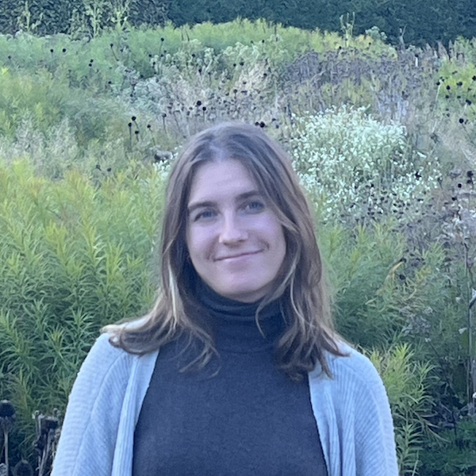

{.float-end width=250px style="margin: 0 0 1rem 1.5rem; border-radius: 8px;"}

I graduated from UCSD in 2019 with a B.S. in Physiology and Neuroscience.
My first research experience was in my study-abroad program during my Sophomore year, at Maastricht University in the Netherlands. 
There, advised by Anna Schueth, I [optically cleared and stained human cortex tissue](https://doi.org/10.1038/s41598-019-47336-9) as part of
the Human Connectome Project, a global effort to map the neural connections in the human brain.
For the rest of my undergraduate years at UCSD I worked on identifying [the presence and roles of two key developmental
proteins in the brain](https://doi.org/10.1002/cne.24886) under Francesca Telese.

After graduation, I worked in Translational Immunology with Dr. Michael Kattah at UCSF, where I helped
start the lab. My work was primarily focused on using organoid models of colon and small intestine cells to 
study [Inflammatory Bowel Disease (IBD)](https://doi.org/10.1172/jci154993).   
Also, I helped lead translational research efforts, and built [a computational pipeline for multi-omics
datasets](https://doi.org/10.1038/s41467-024-45665-6).

In 2023 I started my PhD at UCSD focusing predominantly on both creating new Reinforcement Learning
methods and adapting them as tools for computational neuroscientists to analyze behavior and decision making in humans and primates. I use tools
from information theory and information geometry, you can check out my work on
[mapping neural activity into hyperbolic space](https://doi.org/10.7554/eLife.108234),
and to [build new methods for inverse reinforcement learning](papers/hyperbolic-irl.pdf). 