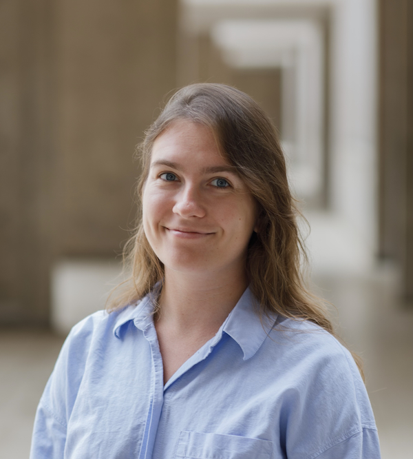

```{=html}
<div class="home-header">
  <div class="home-header-text">
    <div class="home-name">Iulia Rusu</div>
    <p class="home-subtitle">PhD Student · UC San Diego &amp; Salk Institute</p>
    <div class="home-links">
      <a href="#" onclick="this.href = 'mailto:' + ['irusu', 'ucsd.edu'].join('@')"><i class="bi bi-envelope"></i> Email</a>
      <a href="https://scholar.google.com/citations?user=G-KTa-QAAAAJ&hl=en"><i class="bi bi-mortarboard"></i> Scholar</a>
      <a href="https://github.com/iulia-rusu"><i class="bi bi-github"></i> GitHub</a>
    </div>
  </div>
  
</div>
```

Hi, I'm Iulia, a fourth-year PhD student at UC San Diego advised by Tatyana Sharpee. 
I'm a reinforcement learning researcher working on inverse RL and the geometry of reward,
drawing on ideas from computational neuroscience about how the brain represents information.

[Read more about my research.](research.qmd)

<!-- Projects hidden until they are ready to share.
::: {.interests}

::: {.interest}
[](projects/DQN-robot/index.qmd)

[DQN Robot](projects/DQN-robot/index.qmd): Using DQN (Deep Q Network) to Train a Braitenberg Vehicle.
:::

::: {.interest}
[](projects/ECE276B_dynamicprogramming/index.qmd)

[Dynamic Programming](projects/ECE276B_dynamicprogramming/index.qmd): Implementing the Temporal Difference Algorithm
:::

:::
-->

## Publications


